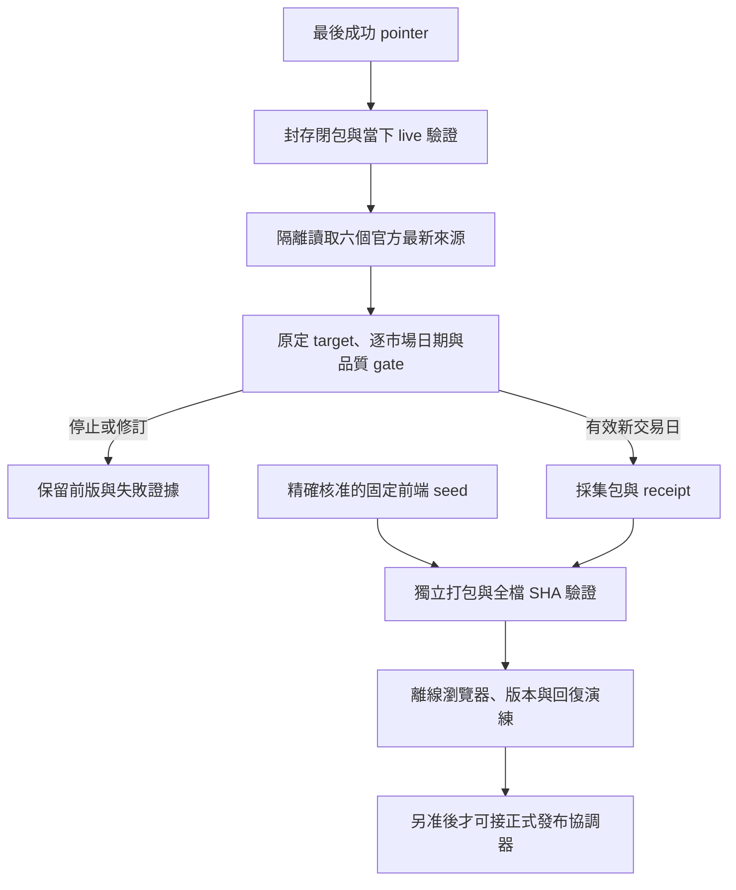

# Stage 4C-1 每日盤後更新維運

校正：2026-10-20。沿用 Draft PR #2 與既有 4C-1B／4C-2B 成果。本輪未啟 schedule、部署、main 合併或正式回復。[本輪驗收與限制](STAGE4C1_REVALIDATION_20261020.md)。

## 正式版與候選

正式站：https://0857ken.github.io/tw-market-scanner/ 。版本 `4b1-rc1`，RC commit `82b1749a2626ce30d6196a101577b8bb09273c31`；Pages Run `38496725153`。TWSE／TPEx 行情日 2026-10-13；market SHA256 `bd5c0630bc3424e7c20aed05cf1f8801af90e34bd27563a9743615b907b1d7f9`。10/12 TWSE 名單、29 檔缺價、日曆部分驗證與 Safari 未驗收仍是原版限制。

4C-1B 已有隔離更新、停止 gate、不可變打包及本機回復；4C-2B 已有持久格式與發布協調離線模型。它們沒有部署到正式站。新每日 manifest 讀取器仍需精確 seed 核准；原版 JS 綁定資料 SHA，不能直接換 JSON。

## 架構與追溯



更新與打包 workflow 均人工、contents:read；打包另需 actions:read。沒有新 Pages／id-token 寫入或 schedule。CI 用 fixture，PR／push 不抓金融 API；缺正式 baseline 時在金融請求前停止。

追溯鏈：原定 target／slot／deadline → 來源 URL、授權、來源日期、response digest／parsed snapshot SHA → acquisition-state 與 processor／parser／schema inventory → source run ID＋attempt、baseline head／generation、seed ZIP／pin → 公開 market、manifest、逐檔與完整 ZIP SHA＋receipt → Release／asset IDs／index → SuccessRecord／pointer。

parsed snapshot SHA 與原 response digest 分欄；`responseBodyArchived:false` 不代表有原 HTTP body。每日打包重用精確 seed、不重建 UI。新資料仍須重驗來源、授權、日期、禁用範圍及同包所有檔案；新雜湊不是資料真實性或核准證據。完整歷史重建、整包欄位限制、核准證據、artifact 綁定與 B08 中斷仍有缺口，不能用離線矩陣 PASS 取代正式驗收。

## 來源與停止條件

| 來源 | 使用方式 |
| --- | --- |
| TWSE 日曆／公司名單 | 既有核准 OpenAPI 最新端點 |
| TWSE 行情 | 資料集 11549 的官方當日 CSV 優先，無歷史日期參數 |
| TWSE 行情 OpenAPI | 僅獨立診斷；CSV 異常不自動 fallback |
| TPEx 名單／行情／法人 | 既有核准的三個最新開放端點 |
| 信用／TWSE T86／未核准歷史 | 不抓取、不啟用 |

- TWSE／TPEx 各讀來源日期，兩市場及 TPEx 法人須符合原定 target；執行／抓取時間不能代替行情日。
- 同日 EOD 下限 16:30 Asia/Taipei；跨午夜保留原 target，既有人工窗口最多一個日曆日，重跑不能改成啟動日。
- 週末或已知 TWSE 休市且來源未變為 no-op；休市日資料變更停止。TPEx 完整日曆／臨時停市未驗證，來源停前日只能判延遲；跨年缺日曆年份證據停止。
- 同日標準化資料不變沿用原 snapshot，HTTP digest 改變另記 lastResponseSha。任何同日修訂都須另列差異、SHA、同包測試與 owner 審核；沒有自動接受開關。
- 每市場有效價格至少 95%，較 baseline 最多下降 2 個百分點；母體變化最多 5%、名單最多落後 7 個日曆日。缺值 null，不補 0／冒稱停牌。
- 日期倒退、雙市場不同步、來源失敗、授權或品質異常即停止，保留最後成功完整站包。
- 403／429 立即停止剩餘來源，不重試／fallback。既有一般 HTTP helper 對其他傳輸錯誤最多兩次；本輪純來源診斷每來源一次。
- output 不覆寫；staging 完整後才 rename 公開。鎖、冪等與預期版本 CAS 防覆寫；本機 flock／rename 不等於跨 runner 分散式交易。

原完整策略 `release_check` 不放寬；信用 pending、T86、還原價、長期均線／突破／回測／法人連續訊號維持停用或暖機。observation-only 不代表 strategyComplete。

## 支援入口與離線重現

```bash
python3 -m pipeline.verified_baseline --help
```

正式 state 完成並經相應核准後，候選入口需要全部精確值；下例不是發布授權：

```bash
python3 -m pipeline.verified_baseline \
  --expected-zip-sha256 "$APPROVED_PUBLISHED_ZIP_SHA256" \
  --expected-generation "$APPROVED_GENERATION" \
  --target-date "$ORIGINAL_TARGET_DATE" \
  --slot "$ORIGINAL_SLOT" --deadline "$ORIGINAL_DEADLINE" \
  --run-id "$SOURCE_RUN_ID" --run-attempt "$SOURCE_RUN_ATTEMPT" \
  --output "$NEW_UNIQUE_OUTPUT" --fetch-current
```

缺 pointer／閉包／live 對應或有 active／halted 交易，停止且無金融請求。舊 run／daily CLI 及 daily_release 直接抓取不受支援；不要繞過 loader、用 fixture 冒充正式 baseline，或建立 market-data 替代。來源診斷成功不賦予候選資格。

```bash
python3 -m pip install -r requirements-dev.txt
npm ci --prefix frontend --no-audit --no-fund
python3 -m scripts.audit_workflows
npm test
npm run build
node scripts/audit-built.mjs
npm exec --prefix frontend -- playwright install chromium
npm run test:e2e
npm run build:rc
npm run test:rc:e2e
node scripts/audit-rc.mjs
node scripts/build-daily-seed.mjs
python3 -m scripts.daily-dry-run --output test-results/NEW-UNIQUE-REHEARSAL
cd frontend
node node_modules/@playwright/test/cli.js test --config playwright.daily.config.js
```

Linux 需可信 Chromium 與系統相依。若本機下載受限，保留限制，由既有 CI 執行三組瀏覽器測試，不換不可信二進位。dry-run 使用 fixture 來源日，不是最新真實候選或正式發布，證據須標 productionDeployed=false。

歷史官方測試 [10/14 證據](STAGE4C1_CURRENT_TEST.json) 被同日名單修訂正確阻擋。本輪 [10/20 來源診斷](STAGE4C1_SOURCE_PROBE_20261020.json) 僅作來源 metadata 核對，不算新交易日完整候選。

## 建議排程與回報（未啟用）

| 台灣時間 | 用途 | 規則 |
| --- | --- | --- |
| 工作日 18:30 | 主 slot | 原定事件交易日與核准日曆 |
| 19:30、20:30 | 最多兩個備援 | 僅來源延遲或短暫傳輸故障；同 target 與去重身份 |
| 21:30 | 當日自動發布截止 | 遲到不改 target，跨午夜只在既有規格內人工處理 |

成功重觸發 no-op。403／429、官方拒絕、同日修訂、日期／品質／授權異常不自動重試。GitHub 可能延遲／漏 slot；需固定 intended slot／deadline。部署 UNKNOWN 不能在下個 slot 再送 create。

summary／failure evidence 應列來源、原定／實際日期、最後成功版與停止原因，涵蓋失敗、資料過期、不同步、漏 slot 與未知部署。可用 GitHub 原生 failure 訂閱；本輪不寄信／LINE。主動新鮮度看門及通知尚待接線／驗收，不能把設計當作運作。網頁保留原行情日期及日曆日延遲。

## 免費額度

2026-10-20 核對官方文件：公開 repo 標準 hosted runner 免費，larger runner 仍計費。Free 列 500 MB artifact／Packages 共享額度，cache 另列每 repo 10 GB。Pages 發布站最大 1 GB、每月頻寬 100 GB soft limit；10 builds/hour soft limit不適用自訂 Actions 發布，仍非無限資源。

容量示例而非帳單：每 slot 10 MiB、每天最多三次、保留七天約 210 MiB，仍須加帳號其他 artifacts／Packages。現有一般診斷七天、瀏覽器截圖一天。完整正式 ZIP、receipt、seed、來源閉包及成功紀錄不能只靠會到期 artifact；保留必要舊版，不自動刪歷史、GC 或付費。

[Actions billing](https://docs.github.com/en/billing/concepts/product-billing/github-actions) · [Pages limits](https://docs.github.com/en/pages/getting-started-with-github-pages/github-pages-limits)。帳號實際使用量／預算未核實，啟用前須確認。本輪不開通付費服務／新增付費依賴。

## 正式發布、回復與 Stage 4C-2 關卡

1. 依精確 commit／內容確認後續修補與 main 合併；本輪不合併。新前端 seed ZIP／pin、gate 政策、slot／deadline、正式發布／回復權限須精確核准，不能用 CLI 字串取代。
2. 關閉完整歷史來源重建、整包公開欄位限制、成功核准證據鏈、Pages artifact／核准 bytes 綁定、B08 實際中斷驗收缺口。
3. 完成既有 4C-2C 範圍：有效 state 保護、orphan／受保護 append 可用管道與專用 authority；原四資產讀回、真 IDs index、immutable Release、同 commit g0；只靠遠端 pointer／Release 乾淨還原。不加 PAT／Secrets、不弱化規則。
4. main 舊更新與首次 Pages 入口退役或接入單一預約／fence，正式 daily writer 才能開放。
5. 真實新交易日從成功 baseline 全鏈到候選；另准一次人工正式發布後，取得精確 Pages ID／succeed 及兩輪所有公開檔 SHA，最後 CAS 才記成功 pointer。
6. 失敗時舊成功 pointer 不動。timeout／取消／runner 消失／response 遺失不證明站點沒變；保留 active／halt、唯讀 reconcile。站點已換而 pointer 未記時先提出唯一證據的補記計畫，不自動重部署。
7. 正式人工回復需精確授權，驗原完整舊 ZIP、其 seed／receipt／來源／政策，經同協調器產生新 generation／rollbackOf，再驗 live；不重新 build、不只換 pointer、不擅自自動 rollback。
8. 驗 TPEx／臨時停市／跨年、iPhone Safari 搜尋／自選持久化／觸控熱力圖／safe-area／刷新錯誤；Chromium 不代替 Safari。
9. 核對免費用量／預算、過期與漏 slot 回報、真實失敗／UNKNOWN／回復驗收；全部完成並另准每日更新後才可啟 schedule。

原 artifact 11862513391 到期 2026-10-21 09:17:40（台北）；已有原包保全與可攜備份紀錄，但遠端 immutable Release 尚不存在。到期不讓既有站點自動下線。4C-2C 已有部分設定，不應重新建規則，也不能誤寫成全部尚未授權／全部完成。
