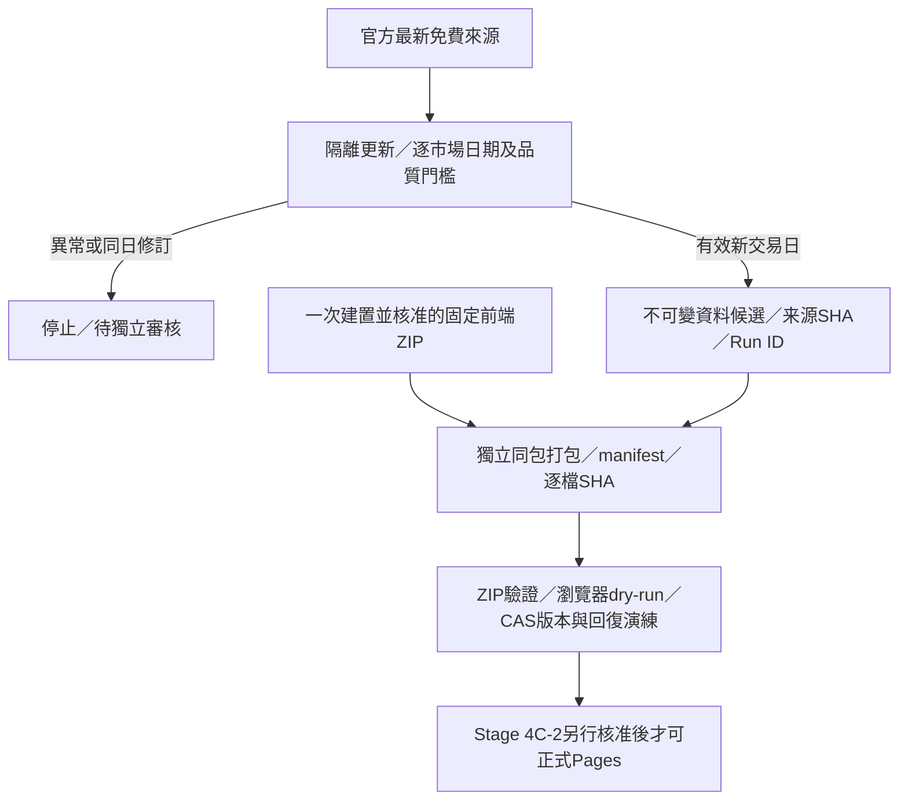

# Stage 4C-1 每日盤後更新候選架構

正式站 https://0857ken.github.io/tw-market-scanner/ 已於 Stage 4B-2 發布固定 `4b1-rc1`，Run 38496725153。正式資料SHA：`bd5c0630bc3424e7c20aed05cf1f8801af90e34bd27563a9743615b907b1d7f9`；行情日2026-10-13。此次只新增 feature、Draft PR、非正式測試；沒有合併、排程、正式部署或付費資源。

## 架構與信任邊界



现有旧update-data.yml使用pipeline.run --strict，會更新不屬於觀察版的模組並可能先推失敗狀態。已改為pipeline.daily --twse-current-csv的隔離副本，再由daily_release核對新版。主repo及正式資料不寫入。market-data查詢回404，目前不存在；更新與Pages不得假設此分支存在，也不自動创建它。Stage 4B-2固定原始ZIP部署workflow維持不動，不會被新行情觸發。

更新workflow與package-daily.yml分開，均人工觸發、contents:read，打包只有actions:read；沒有Pages或id-token寫入權限。CI只取得fixture，沒有每次PR抓金融API。打包工作只消費本repo成功update-data與CI的同一固定code SHA/run attempt，前端種子ZIP另以精確SHA指定；不在每日打包執行Vite。

正式4b1-rc1前端把資料SHA寫入JS，不能直接換JSON。候選版新增每日manifest讀取器；同源、版本、frontendId、每次全新資料SHA、来源版本、冻结功能及資料契約均檢查。旧固定RC方式保留。策略/研究公式没有修改。日後每日重用核准種子的index/JS/CSS位元組，不能從main重新build。**這個新前端仍待一次性Stage 4C-2核准，未部署。**

manifest不是獨立數位簽章；信任邊界為HTTPS、受保護的repository與經驗證發布workflow。前端核對防止資料與manifest跨版本快取、失敗或無授權profile；後端再次核對授權政策SHA、allowlist、日期、來源與完整資源SHA。不能靠改新雜湊就冒充資料合法。

## 日期、資料來源與停止條件

- TWSE優先政府資料集11549列示的**最新當日CSV**（无历史date参数）。OpenAPI同名行情為獨立診斷來源，不能用較舊OpenAPI覆蓋較新CSV；目前不会遇到CSV異常就fallback或繞過官方限制。
- TPEx只取已核准最新公司名單、盤後行情与三大法人快照。T86、信用、300日歷史不請求。TPEx法人不是完整上市櫃法人；长連續讯号停用。
- 用来源自己的TWSE／TPEx日期，兩市場必須一致且符合原定target_date；法人日期相同。執行時間／抓取時間不代替行情日期。
- 16:30以前不接受同日EOD；跨午夜執行仍保留原target，最多容許1個日曆日延遲，太晚/未完成/未來target直接拒絕。正式排程啟用前，須由原定事件slot計算target，不得以retry日期重算。
- 週末與TWSE已知休市保守no-op；如果休市日出現變更行情停止。TPEx獨立完整日曆與臨時停市尚未完整驗證；舊來源停留前日視為delay、停止發布，**不能推定臨時休市**。新年度沒有日曆年份證據則停止，待確認，不猜跨年交易日。
- 有效價格最低95%，較最後有效版本下降超過2百分點、母體数量变化超過5%、名單老於7日曆日，停止。29檔已知缺價仍為null/原因未知，不補零或判為停牌。
- 日期倒退、兩市場不同步、同日標準化行情变更、新來源版本、來源失敗與授權不符停止。源回應內容雜湊改變但標準化資料完全相同，沿用舊不可變snapshot並记录lastResponseSha，不冒充新行情。
- 403/429為終止错误；HTTP helper不再重試，受控update立即停止剩餘來源，不繞過。傳輸逾時最多原helper的兩次有限嘗試，不無限輪詢。
- 同日企業名單/其他來源修訂也會保守阻擋，須在獨立feature審閱具體来源SHA与差異、測試新的完整bundle，再由owner核准；沒有自動accept-revision開關。

## 追溯與可重現性

每次候選保存：原定target、實際各市場日期、来源URL／授權證據／抓取時間／HTTP回應SHA、標準化snapshot鏈、输入SHA、輸出公開market SHA、sourceIdentitySha、许可政策SHA、processorCommit、source Run ID、固定frontend pin、逐檔SHA、manifest SHA和整個ZIP SHA。archive entries固定時間，ZIP不可覆蓋。

CI的`ci-fixture-<Run ID>`明確是離線已取來源資料演練，不能聲稱最新行情。正式候选必须来自独立成功更新run的candidate gate。

`pipeline.daily_state`只在本機暫存store演練完整ZIP儲存、immutable ledger、鎖與CAS current pointer；預期前版不符則拒绝，重复worker不能覆蓋，寫入中断不变更最後完整pointer。舊ZIP保留，回復重新驗证完整旧包且CAS；此API不是正式網站操作。

## 本次受控官方測試

2026-10-14 09:55 Asia/Taipei啟動，一次低負載測試、六個最新端點。沒有歷史/T86/信用请求。六來源均取得/驗證成功；另一次TWSE OpenAPI獨立診斷也為10/13（1095列，SHA見證據JSON），未用它替換CSV：TWSE行情与TPEx行情、法人均2026-10-13；TWSE公司名單从10/12到10/13，SHA `e13ad5d1be3d68ea8ba2ae73203bbeccca3a1a8473b71694dd8d0727db7c9aa5`。有效上市1081/1085=99.63%，上櫃868/893=97.20%；总1949/1978=98.53%，缺29。

**发布gate正确停止于same-day revision requires separate review。** 不是API失败、不是新交易日，也不是已发布新版；没有以执行10/14冒充来源行情10/14。完整attempt/failure证据见STAGE4C1_CURRENT_TEST.json。离线成功新日用真实10/8 baseline与10/13 fixture验证；打包、浏览器與回復均为非正式演练。

## 建议将来排程及失败通报（本阶段不启用）

建議台灣工作日18:30主slot；來源延遲/短暫傳輸故障最多19:30、20:30各一個備援slot，全部使用同一原定交易日和CAS去重。21:30後不做當天補發布，跨午夜只可保留原target做限定人工重跑。已完成版本no-op；403/429、修订、覆盖率/授权/日期异常不自动重试，人工处理。

GitHub Actions可能延遲或丢slot；workflow timeout-minutes 8／concurrency cancel:false/单一更新组防止並發。用户可開啟GitHub原生workflow failure邮件通知，工作summary及failure.json列明來源、日期、最後有效版本。休市no-op不是failed；delay/日期不同步會失败/告警。没有授权发送LINE/邮件、沒有外部通知服務。没有新排程即无法实现主动每日过期监测；浏览器显示原行情日期與日曆日延遲，Stage 4C-2应批准独立同slot报告。

公開repo標準ubuntu-24.04 runner免費；不用larger runner、paid datasource或外部雲端。GitHub Free儲存额度500MB、Pages成品1GB/每月100GB soft bandwidth，應同repo及帳號artifact使用量一起檢查；不是保證無限儲存。工作artifact7日、診斷7日，前後兩個**核准完整正式ZIP及receipt**需要持久保存在repository受控release/state，不依赖artifact到期，也不要每日重建全历史大包。本stage尚未建立正式release/state分支。官方證據：
https://docs.github.com/en/billing/concepts/product-billing/github-actions
https://docs.github.com/en/pages/getting-started-with-github-pages/github-pages-limits

## 非正式重现

```bash
npm test
npm run build
node scripts/audit-built.mjs
npm run test:e2e
npm run build:rc
npm run test:rc:e2e
node scripts/audit-rc.mjs
node scripts/build-daily-seed.mjs
python -m scripts.daily-dry-run
cd frontend
node node_modules/@playwright/test/cli.js test --config playwright.daily.config.js
```

仅需要额外人工请求最新数据时，在repo根目录执行下面命令（原target须正确；不能再用pipeline.run --strict作为盘后观察正式更新器）：

```bash
python -m pipeline.daily_release --output test-results/stage4c1-current --target-date YYYY-MM-DD --run-id UNIQUE-MANUAL-ID --fetch-current
```

同日修訂停止即保留證據等待owner，不重复抓取以绕过。整个原data目录/正式快照不变。

## Stage 4C-2正式发布与回復的必要前置

1. 明确核准本Draft PR的固定commit合併；核准新的manifest读者前端完整seed ZIP与static pin。现有4b1-rc1不能直接换JSON。
2. 核准同日TWSE名單修订的新SHA和影响，或等待新的有效行情日与独立审核通过候选；不可忽略本次挡下结果。
3. 核准自动数据gate阈值、18:30及备援slots、target_date规则、已知休市/临时停市安全停止和日历不足限制。审查跨年TPEx证据；不得宣称日历完整。
4. 核准正式publish workflow（仅部署job pages:write/id-token:write）与人工初始化后自动发布权限。**此stage没有安装该自动部署job，也没有打开任何repo variable。**
5. 建立受保护不可变state/完整ZIP存储，确定owner审核后第一版seed以及现有4b1正式ZIP为真实最后有效版本；更新job只读已成功published pointer，不可读未批准market-data。发布前CAS/重新验包、备份旧ZIP。发布后HTTPS获取每个asset/manifest/market，逐个比SHA后记successful pointer与run。
6. 核准自动正式回復或改为故障后人工授权；默认停止并报告，不擅自回退/撤站。首次4b1发布时并不存在前一正式版本；未来第一次新版成功后才有此前真实正式版本。
7. iPhone Safari实机验收（搜尋、自選股持久化、触控热力图、底栏safe-area与刷新错误）；本stageChromium不等于Safari。
8. 检查免费储存/带宽总额度；授权GitHub原生通知设置或独立报告，避免额外服务。实际source迟延后先手动成功一次全链再启schedule。

正式更新未来的顺序应为：读取最后successful指针/备份原ZIP → 受控取得最新来源 → 数据gate → 原子候选 → 独立固定前端打包/全SHA验证 → CAS确认最后正式版未变 → 单次Pages → HTTPS逐檔驗證 → 记成功指针。**网站发布后的重大问题立即报告，未授权自动rollback前只能停止。** Pages平台发布和state pointer不是跨系统事务，需要幂等协调及发布中/未知状态的人工恢复验收；这个生产协调实现属于4C-2，不能把本机CAS演练当作已完成正式自动更新。
